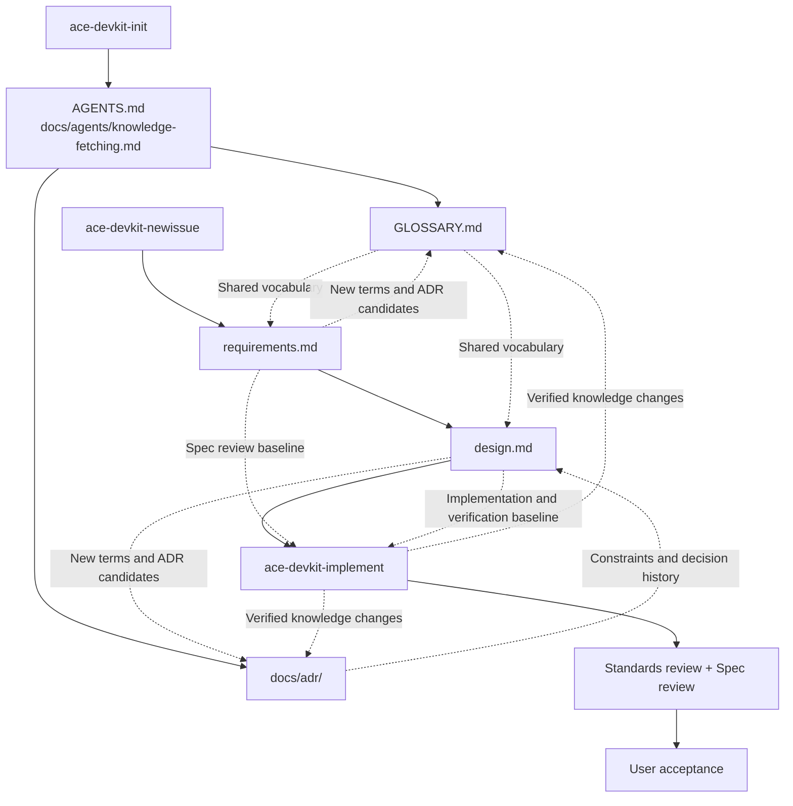

# Ace DevKit

[简体中文](README.zh-CN.md) | English

Ace DevKit is a collection of software-development workflow skills for Codex. It connects requirement discovery, technical design, project knowledge maintenance, implementation, and independent review into one reviewable workflow. The goal is to make the agent understand the project before it changes code, then verify both the implementation and the project documentation before work is considered complete.

The workflow instructions are currently written mainly in Chinese. The skills run in the Codex CLI, the Codex IDE extension, and Codex in the ChatGPT desktop app.

## The problem

When a coding agent starts implementing immediately, several problems commonly follow:

- Terms drift between conversation, documentation, and code.
- Requirements exist only in chat, so scope, acceptance criteria, and later changes are difficult to verify.
- Technical choices have no recorded rationale, leaving future maintainers to guess why the systems look the way they do.
- Implementation review checks whether the code works but not whether it solves the confirmed problem.
- Project knowledge is fragmented across sessions, code, and documents, forcing every new session to reconstruct context.

Ace DevKit stores the required context in `GLOSSARY.md`, ADRs, and per-issue requirement and design documents. Separate implementation and review workflows constrain how the agent changes the project.

## Core concepts

| Artifact | Question it answers | Lifecycle |
| --- | --- | --- |
| `GLOSSARY.md` | What does a project term mean? | Holds the currently valid vocabulary; definitions are updated in place |
| `docs/adr/NNNN-*.md` | Why was this difficult-to-reverse approach selected? | Decision history; changing an accepted decision creates a replacement ADR |
| `requirements.md` | What problem are we solving, and what are the scope and acceptance criteria? | One per issue; becomes the confirmed requirement baseline |
| `design.md` | How will we solve it, and what are the important trade-offs and validation strategy? | One per issue; becomes the confirmed implementation baseline |
| Implementation review | Does the code follow project standards, and does it implement the confirmed requirement? | Runs for each implementation and for affected fixes |

In this project, an “issue” is a pair of project-local requirement and design documents. It does not require a specific issue tracker.

### How the artifacts relate



`GLOSSARY.md` contains terminology only, with no implementation details. An ADR is created only when a decision is hard to reverse, surprising without context, and the result of a real trade-off. Requirements and design live under `docs/issues/<id>-<topic>/` in files named `requirements.md` and `design.md`.

Implementation starts from the confirmed requirements, design, and relevant project knowledge. The agent first develops against the project's TDD and design constraints, then runs two independent read-only reviews:

- **Standards review** checks project conventions, design boundaries, and existing ADRs.
- **Spec review** checks for missing, incorrect, or unrequested behavior relative to the confirmed requirement.

Passing tests and review is not the same as user acceptance. The implementation workflow finishes only after the user explicitly accepts the result.

## Included skills

| Skill | When to invoke it | Main outputs |
| --- | --- | --- |
| `ace-devkit-init` | The first time Ace DevKit is enabled in a project, or when the project entry rules need repair | Entry rules in `AGENTS.md` and `docs/agents/knowledge-fetching.md` |
| `ace-devkit-newissue` | Starting a new feature, defect, or change that needs requirement discovery and technical design | `requirements.md`, `design.md`, confirmed terminology, and ADRs |
| `ace-devkit-implement` | Requirements and design are confirmed; the work is ready for implementation, testing, review, and acceptance | Code changes, test results, review findings, and final knowledge-base changes |

All three skills require explicit invocation.

## Installation

Requirements:

- Git
- A Codex version that supports skills
- A Git project where Ace DevKit will be used

Clone this repository:

```bash
mkdir -p "$HOME/src"
git clone https://github.com/goace/ace-dev-kit.git "$HOME/src/ace-dev-kit"
```

Current Codex releases load personal skills from `$HOME/.agents/skills` and follow symlinked skill folders. See the [Codex skills documentation](https://learn.chatgpt.com/docs/build-skills). Link each skill into that directory:

```bash
REPO_ROOT="$HOME/src/ace-dev-kit"
SKILLS_DIR="$HOME/.agents/skills"

mkdir -p "$SKILLS_DIR"
ln -sfn "$REPO_ROOT/skills/ace-devkit-init" "$SKILLS_DIR/ace-devkit-init"
ln -sfn "$REPO_ROOT/skills/ace-devkit-newissue" "$SKILLS_DIR/ace-devkit-newissue"
ln -sfn "$REPO_ROOT/skills/ace-devkit-implement" "$SKILLS_DIR/ace-devkit-implement"
```

Replace `REPO_ROOT` if the repository is cloned elsewhere. Codex detects skill changes automatically; restart it if the skills do not appear.

View or select installed skills:

```text
/skills
```

Invoke a skill explicitly with `$`:

```text
$ace-devkit-init
```

If your Codex version still uses `$CODEX_HOME/skills`, follow the installation documentation for that version.

## Quick start

### 1. Initialize the target project

Open the target Git repository and invoke:

```text
$ace-devkit-init
```

The skill installs the project knowledge entry point. It does not create an empty `GLOSSARY.md` or ADR immediately. Those files are created only after a term or durable decision actually exists.

### 2. Start a new issue

```text
$ace-devkit-newissue
I want to add device management to the login flow so users can view and revoke signed-in devices.
```

The skill first clarifies the requirement and acceptance criteria, then writes `requirements.md`. After the user confirms the requirement as a whole, it produces `design.md`, including important trade-offs, validation strategy, and ADR candidates. Both documents require explicit user confirmation.

### 3. Start implementation

After confirming the requirement and technical design, continue through the new-issue workflow or invoke implementation directly:

```text
$ace-devkit-implement
Read docs/issues/0001-device-management/requirements.md and design.md, then implement the change.
```

The implementation skill will:

1. Read the glossary, relevant ADRs, and codebase design rules.
2. Preserve a baseline before changes so pre-existing user edits are excluded from this task's review.
3. Implement against the confirmed design and run the relevant tests.
4. Start independent Standards and Spec review subagents in parallel.
5. Fix material in-scope findings and re-review affected changes.
6. Request user acceptance.
7. Complete the terminology and ADR review after acceptance.

## Repository layout

```text
skills/
├── ace-devkit-init/
├── ace-devkit-newissue/
├── ace-devkit-implement/
└── shared/
    ├── codebase-design/
    └── knowledge-base/
```

Files created in a target project as needed:

```text
AGENTS.md
GLOSSARY.md
docs/
├── agents/knowledge-fetching.md
├── adr/
│   └── 0001-device-session-lifecycle.md
└── issues/
    └── 0001-device-management/
        ├── requirements.md
        └── design.md
```

Files are created lazily. Initialization does not manufacture an empty knowledge base, and a decision that does not meet the ADR threshold is not recorded merely to complete a template.

## Compatibility and dependencies

- The project targets Codex only and does not claim compatibility with other coding agents.
- The current test environment uses Codex `0.164.0`.
- The existing `ace-devkit-implement` workflow references `$codex-plan-tool`. The full implementation flow currently expects that skill to be available locally. Without it, the progress-tracking step may need adjustment.
- These skills ask the agent to modify code, run tests, and delegate read-only subagents. Users remain responsible for checking the final changes, test results, and review findings.

## Design principles

- Documentation is context for the agent, not ceremony for its own sake.
- Facts come first from real code, tests, and the project knowledge base.
- Record terminology and decisions only when they have value.
- Implementation and independent review use separate contexts.
- Confirm requirements and important design decisions before implementing.
- Passing tests, passing review, and user acceptance are three distinct states.

## Developing Ace DevKit

This repository also uses the Ace DevKit workflow:

- Define the maintenance goal and affected workflow before changing a skill or reference document.
- After a substantive skill behavior change, run a realistic scenario replay with an independent subagent that does not inherit the development conversation.
- Keep relative Markdown links valid and confirm that each `SKILL.md` has a `name`, a `description`, and a clear trigger boundary.

## License

[MIT](LICENSE)
