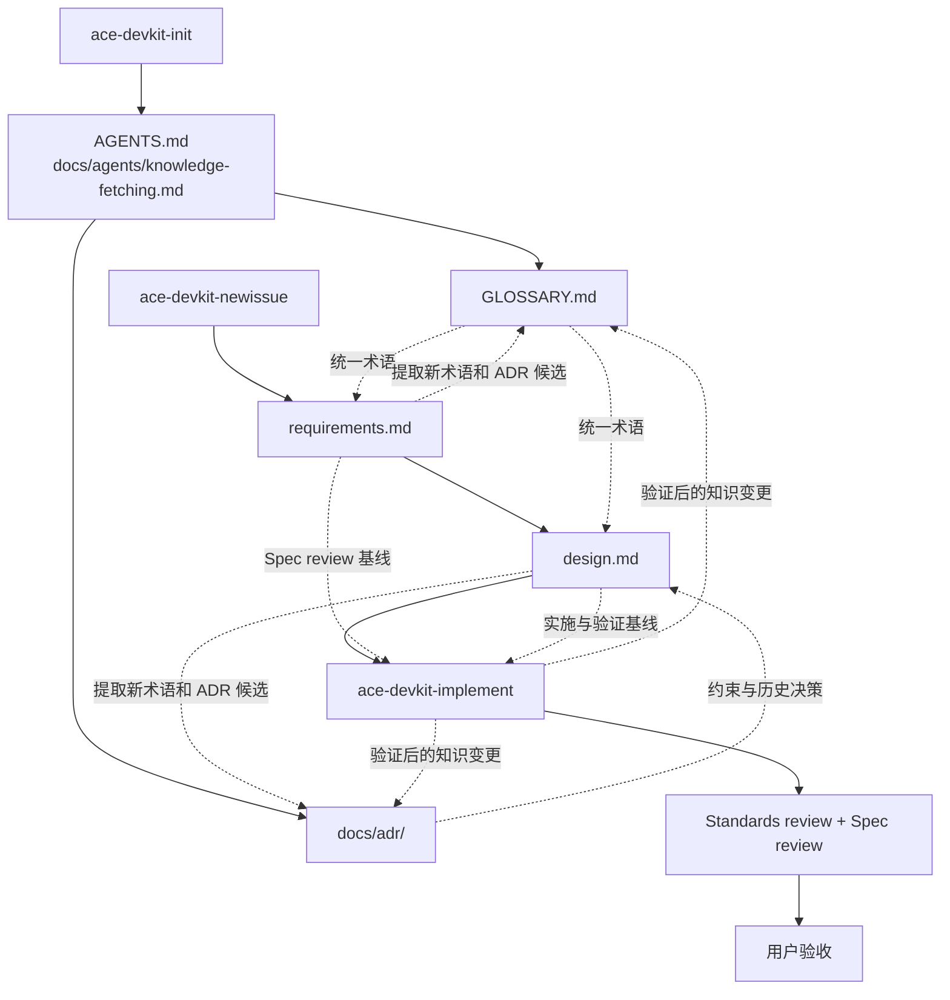

# Ace DevKit

[English](README.md) | 简体中文

Ace DevKit 是一组面向 Codex 的软件开发工作流 skill。它把需求澄清、技术设计、知识库维护、实施和独立 review 串成一条可检查的流程，让 agent 在开始修改代码前先理解项目，在结束工作前再核对实现与文档是否一致。

当前内容以中文为主，适用于 Codex CLI、Codex IDE 扩展和 ChatGPT 桌面应用中的 Codex。

## 解决的问题

让 coding agent 直接进入实现，通常会出现这些问题：

- 术语含义不统一，讨论中的概念和代码里的行为逐渐偏离。
- 需求只存在于聊天中，范围、验收条件和后续变更难以核对。
- 技术取舍没有留下理由，后来的维护者不知道为什么要这样设计。
- 实现完成后只检查代码能不能运行，没有同时检查它是否满足需求。
- 项目知识散落在会话、代码和文档中，新会话需要重新猜测上下文。

Ace DevKit 用 `GLOSSARY.md`、ADR 和每个 issue 的需求、设计文档保存必要上下文，并用独立的实施与 review 流程约束 agent 的行为。

## 核心概念

| 产物 | 回答的问题 | 生命周期 |
| --- | --- | --- |
| `GLOSSARY.md` | 项目里的术语是什么意思 | 当前有效词汇，定义变化时原地修订 |
| `docs/adr/NNNN-*.md` | 为什么选择这个难以逆转的方案 | 决策历史，已接受的决策改变时新建替代 ADR |
| `requirements.md` | 要解决什么问题，范围与验收条件是什么 | 每个 issue 一份，确认后作为需求基线 |
| `design.md` | 准备怎样解决，重要取舍和验证策略是什么 | 每个 issue 一份，确认后作为实施基线 |
| 实施 review | 代码是否满足标准，是否实现了确认的需求 | 每次实施和受影响修复后执行 |

这里的 “issue” 是一组项目内需求与设计文档，不要求使用某个特定的 issue tracker。

### 各产物之间的关系



`GLOSSARY.md` 只记录术语，不记录实现细节。ADR 只记录同时满足“难以逆转、缺少背景会显得反常、来自真实取舍”的决策。需求和设计保存在 `docs/issues/<id>-<topic>/` 中，文件名分别是 `requirements.md` 和 `design.md`。

实施阶段会读取已确认的需求、设计和相关知识，先按 TDD 和项目设计约束开发，再启动两个独立的只读 review：

- Standards review：检查代码是否符合仓库规范、设计边界和既有 ADR。
- Spec review：检查实现是否遗漏、偏离或过度扩张已确认的需求。

测试和 review 通过不等于用户验收通过。只有用户明确确认最终结果后，实施流程才结束。

## 包含的 skill

| Skill | 调用时机 | 主要产物 |
| --- | --- | --- |
| `ace-devkit-init` | 在项目中第一次启用，或需要修复项目级入口时 | `AGENTS.md` 中的入口规则、`docs/agents/knowledge-fetching.md` |
| `ace-devkit-newissue` | 开始一个需要澄清需求和技术方案的新功能、缺陷或改造 | `requirements.md`、`design.md`，以及确认后的术语和 ADR |
| `ace-devkit-implement` | 需求和设计已经确认，准备开发、测试、review 和验收时 | 代码改动、测试结果、review 结论、最终知识库变更 |

三个 skill 都设置为只接受显式调用。

## 安装

需要：

- Git；
- 支持 skills 的 Codex 版本；
- 一个准备使用 Ace DevKit 的 Git 项目。

把仓库克隆到本机：

```bash
mkdir -p "$HOME/src"
git clone https://github.com/goace/ace-dev-kit.git "$HOME/src/ace-dev-kit"
```

当前 Codex 从 `$HOME/.agents/skills` 加载个人 skill，并支持软链接。安装规则见 [Codex skills 文档](https://learn.chatgpt.com/docs/build-skills)。把三个 skill 分别链接进去：

```bash
REPO_ROOT="$HOME/src/ace-dev-kit"
SKILLS_DIR="$HOME/.agents/skills"

mkdir -p "$SKILLS_DIR"
ln -sfn "$REPO_ROOT/skills/ace-devkit-init" "$SKILLS_DIR/ace-devkit-init"
ln -sfn "$REPO_ROOT/skills/ace-devkit-newissue" "$SKILLS_DIR/ace-devkit-newissue"
ln -sfn "$REPO_ROOT/skills/ace-devkit-implement" "$SKILLS_DIR/ace-devkit-implement"
```

把 `REPO_ROOT` 改成实际克隆路径。安装后 Codex 会自动发现变更；如果没有出现，重启 Codex。

查看或选择 skill：

```text
/skills
```

显式调用使用 `$`：

```text
$ace-devkit-init
```

如果你的 Codex 版本仍使用 `$CODEX_HOME/skills`，请以对应版本的官方文档为准。

## 快速开始

### 1. 初始化目标项目

进入目标 Git 仓库并调用：

```text
$ace-devkit-init
```

它会安装项目级知识入口，不会立刻创建空的 `GLOSSARY.md` 或 ADR。只有在确实出现术语或值得记录的决策时才创建这些文件。

### 2. 开始一个新 issue

```text
$ace-devkit-newissue
我要为登录流程增加设备管理，用户可以查看并撤销已登录设备。
```

skill 会先澄清需求和验收条件，写入 `requirements.md`。需求整体确认后，再形成 `design.md`，讨论重要取舍、验证方式和 ADR 候选。两个文档都必须由用户明确确认。

### 3. 进入实施

确认需求和技术设计后，可以直接在 newissue 流程中进入实施，也可以显式调用：

```text
$ace-devkit-implement
读取 docs/issues/0001-device-management/requirements.md 和 design.md，完成实施。
```

实施 skill 会：

1. 读取术语表、相关 ADR 和代码库设计规则；
2. 保留修改前基线，避免把用户原有改动混入本次 review；
3. 按确认的设计实现并运行相关测试；
4. 并行启动 Standards 和 Spec 两个独立 review subagent；
5. 修复范围内的实质问题并复查受影响部分；
6. 请求用户验收；
7. 验收通过后完成本轮术语和 ADR 回顾。

## 目录结构

```text
skills/
├── ace-devkit-init/
├── ace-devkit-newissue/
├── ace-devkit-implement/
└── shared/
    ├── codebase-design/
    └── knowledge-base/
```

目标项目中按需生成：

```text
AGENTS.md
GLOSSARY.md
docs/
├── agents/knowledge-fetching.md
├── adr/
│   └── 0001-device-session-lifecycle.md
└── issues/
    └── 0001-device-management/
        ├── requirements.md
        └── design.md
```

文件按需创建。初始化不会制造空知识库，也没有值的决策不会为了流程完整而创建 ADR。

## 兼容性与依赖

- 项目只面向 Codex，不承诺兼容其他 coding agent。
- 当前测试环境使用 Codex `0.164.0`。
- `ace-devkit-implement` 的现有流程引用 `$codex-plan-tool`。使用完整实施流程前，需要在本机提供该 skill；如果环境中没有它，实施 skill 的进度跟踪步骤可能需要调整。
- 这些 skill 会要求 agent 修改代码、运行测试和委派只读 subagent。用户仍应检查最终改动、测试结果和 review 结论。

## 设计原则

- 文档是 agent 的上下文，不是形式化交付物。
- 事实优先从真实代码、测试和项目知识库获得。
- 只记录有价值的术语和决策。
- 写代码和独立 review 由不同上下文承担。
- 先确认需求和重要设计，再实施。
- 测试通过、review 通过和用户验收是三个不同状态。

## 开发这个项目

本仓库自身也使用 Ace DevKit 的工作方式：

- 修改 skill 或参考文档时，先明确维护目标和受影响流程。
- 实质性修改 skill 行为后，用不继承开发讨论历史的独立 subagent 做真实场景回放。
- 保持 Markdown 相对链接有效，并确认 `SKILL.md` 的 `name`、`description` 与触发边界一致。

## License

[MIT](LICENSE)
